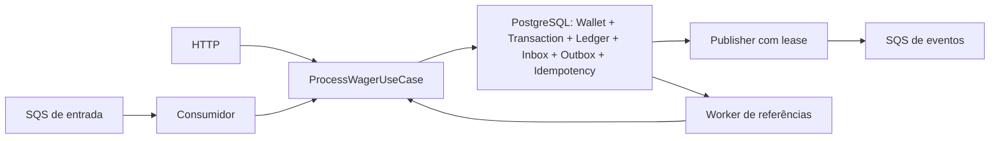

**ANDREHLB DEVLAB · DISTRIBUTED WAGERING PROCESSOR**

   

Documentação interligada · paleta: creme, areia, grafite, sálvia e coral

---

# Arquitetura — Distributed Wagering Processor

## Estrutura e responsabilidade

O domínio existente foi preservado: `Money`, `Wallet`, `WagerTransaction` e `WalletLedgerEntry`. O domínio não depende de NestJS, ORM ou SDK AWS. As factories encapsulam criação/reidratação; as transições financeiras são explícitas. A aplicação coordena transações; HTTP e SQS são adaptadores para o mesmo `ProcessWagerUseCase`.

O código usa MikroORM PostgreSQL com `EntityManager.fork().transactional()`. SQL explícito por `tx.execute` mantém visíveis os locks, as constraints e a fronteira atômica. Os metadados `EntitySchema` representam tipos exatos, FKs, índices, Inbox, Outbox e chaves de idempotência. Não há outro ORM nem cliente de banco alternativo.

## Dinheiro e integridade financeira

Money armazena centavos em `bigint`; nenhuma operação monetária usa `number`. Contratos exigem string decimal não negativa com duas casas; o serviço recebe apenas BRL. O domínio aceita códigos de moeda suportados pelo ICU do runtime e detecta conflitos entre moedas. Valores internos negativos são possíveis para cálculo de diferenças, sem permitir saldo negativo.

PostgreSQL persiste `numeric(30,2)` como string. Entradas e créditos que excederiam 28 dígitos inteiros são rejeitados explicitamente. O saldo inicial positivo gera OPENING, ledger CREDIT e dois eventos na mesma transação. Saldo inicial zero não gera OPENING nem ledger. A versão inicial é 1.

Cada alteração de saldo gera exatamente um lançamento; LOSS e rejeições não geram lançamento nem incrementam versão. O SQL protege saldo não negativo, versão, unicidade de carteira, identidade externa e chave, aritmética do ledger, FKs, lançamento único por transação/carteira e reversão única por referência/tipo.

Triggers impedem UPDATE/DELETE/TRUNCATE do ledger, mutação de transações terminais e alteração de identidades financeiras. Constraints triggers diferidos verificam no commit que o saldo equivale à soma do ledger, que os lançamentos correspondem às transações processadas e que operações financeiras processadas possuem ledger. O SQL de migrations gerencia esses triggers; `schemaGenerator.ignoreTriggers=true` impede que um diff automático proponha removê-los. Testes exercitam os triggers diretamente. Não se usa `schema:update` como mecanismo de deploy.

A reconciliação lê saldo e soma do ledger no mesmo snapshot MVCC. Retorna a diferença, registra log e métrica se houver divergência; não faz ajustes silenciosos.

## Concorrência e idempotência

A transação primeiro obtém advisory locks transacionais por identidade externa, chave e mensagem de Inbox, em ordem determinística. Em seguida bloqueia somente a linha da wallet com `FOR UPDATE`. Carteiras/identidades distintas não compartilham um lock global. Todas as instâncias obedecem à mesma estratégia; PostgreSQL arbitra disputas. A versão incrementa somente quando o saldo muda, reforçada por trigger.

Antes de criar uma operação, o caso de uso procura tanto a chave persistida quanto a identidade `(providerId, externalTransactionId)`. Um payload diferente produz 409. Replay com uma chave adicional vincula essa chave à mesma transação em `wager_idempotency_keys`, na mesma transação SQL. Ela permanece reservada contra uso futuro com outro payload. As unicidades do banco são a garantia final.

O hash é SHA-256 do JSON com chaves recursivamente ordenadas, sem espaços; campos undefined são omitidos. Entram somente providerId, externalTransactionId, playerId, walletId, roundId, gameId, kind, money e referência, quando presente. Idempotency-Key, correlationId, datas e metadados de transporte não entram. Para as BETs anteriores à auditoria, há compatibilidade com o hash em ordem fixa, somente quando não existe `original_response`.

A primeira resposta de aceitação é persistida em `original_response`. Replay muda apenas `idempotentReplay`; preserva status, saldo e failureCode originais. Para 202, GET retorna a evolução posterior. O snapshot corrente da transação evolui durante o retry; a resposta original permanece imutável. Aberturas históricas recuperam snapshot pelo ledger, sem alterar lançamentos.

## Operações, estados e referências

| Operação | Efeito | Regra |
| --- | --- | --- |
| OPENING | Crédito | Somente criação interna, saldo inicial positivo |
| BET | Débito | Exige saldo suficiente |
| WIN | Crédito | Referência opcional a BET da mesma rodada |
| LOSS | Nenhum | Valor positivo informativo; sem ledger |
| REFUND | Crédito | BET processada, mesmo valor; uma vez por tipo |
| ROLLBACK | Inverso | BET, WIN ou REFUND processada, mesmo valor; uma vez por tipo |

Referências devem ter o mesmo provider, player, wallet, moeda e rodada. O gameId não integra a identidade de rodada exigida. Reversões parciais e autorreferências são inválidas. Conforme a regra de unicidade por tipo, uma BET pode receber um REFUND e um ROLLBACK distintos; cada tipo pode ocorrer uma única vez. ROLLBACK de ROLLBACK não é permitido.

A criação nasce em PENDING. Pode transitar para PROCESSED, REJECTED, FAILED ou PENDING_REFERENCE. PENDING_REFERENCE pode permanecer pendente durante retry ou chegar a um estado terminal. PROCESSED, REJECTED e FAILED não mudam mais. FAILED existe no domínio para erros permanentes auditáveis; erros de transporte não transformam automaticamente operações já confirmadas em falhas financeiras.

Se uma referência não existir ou ainda não estiver processada, a operação dependente fica PENDING_REFERENCE. A mesma interpretação se aplica a WIN quando uma referência opcional foi fornecida. Um worker agenda retries persistidos: início em 1 segundo, backoff exponencial, teto de 5 minutos. Após 12 retries ou 24 horas desde a criação, rejeita com REFERENCE_NOT_FOUND e grava o evento de rejeição. O limite evita pendências infinitas; referências que cheguem após o limite exigem intervenção operacional, sem mutar o estado terminal.

Códigos financeiros: `INSUFFICIENT_FUNDS`, `ROLLBACK_INSUFFICIENT_FUNDS`, `INVALID_REFERENCE`, `ALREADY_REVERSED`, `REFERENCE_NOT_FOUND`, `BALANCE_LIMIT_EXCEEDED`. Códigos de transporte/validação: `INVALID_WAGER_INPUT`, `INVALID_WALLET_INPUT`, `REFERENCE_REQUIRED`, `INVALID_MONEY_AMOUNT`, `INVALID_CURRENCY`, `UNSUPPORTED_CURRENCY`, `AMOUNT_OUT_OF_RANGE`, `UNSUPPORTED_TRANSACTION_KIND`, `IDEMPOTENCY_CONFLICT`, `INBOX_PAYLOAD_CONFLICT`, `WALLET_ALREADY_EXISTS`, `INFRASTRUCTURE_UNAVAILABLE`. Erros HTTP não expõem SQL, parâmetros ou credenciais.

## Inbox, ACK, retry e shutdown

A Inbox possui PK `(consumerName,messageId)` e hash do payload de negócio mais a chave de transporte. Reutilizar messageId com payload/chave diferente é conflito permanente e vai para DLQ. Wallet, transação, ledger, Inbox, vínculos de idempotência e Outbox são confirmados juntos. Replay por outro messageId pode registrar outra Inbox sem repetir a operação financeira.

O ACK ocorre após `execute()` retornar, portanto após o commit SQL. Uma morte antes do commit causa rollback; após commit e antes do ACK, redelivery encontra Inbox/idempotência e retorna o resultado anterior. Rejeições financeiras persistidas são terminais e recebem ACK. Pendências também recebem ACK porque o banco passa a controlar sua resolução.

Falhas transitórias recebem backoff de visibilidade `2^receiveCount` segundos, limitado a 5 minutos. No quinto recebimento, a mensagem vai para DLQ. Payload inválido, recurso inexistente ou conflito permanente vão diretamente para DLQ. O envio à DLQ é confirmado antes de remover a mensagem original. A fila também tem RedrivePolicy com cinco recebimentos, protegendo contra mortes que impeçam o tratamento pelo consumidor.

A visibilidade é renovada enquanto a mensagem está em processamento. Em SIGTERM, os loops deixam de buscar trabalho e aguardam as operações atuais, incluindo ACK. O Compose reserva 45 segundos para shutdown. Em morte abrupta, a recuperação depende de expiração de visibilidade/leases e do registro persistente.

## Transactional Outbox

A aplicação apenas grava eventos durante a transação financeira. O publisher lê eventos já confirmados usando `FOR UPDATE SKIP LOCKED`, registra token de posse e lease de 60 segundos, confirma a reserva e publica fora da transação. O lease é renovado durante o batch. A confirmação de publicação exige o mesmo token; outro processo recupera reservas expiradas.

Falhas mantêm o evento PENDING, incrementam attempts e persistem próximo envio com backoff de 1 segundo a 5 minutos. Eventos confirmados nunca são descartados por limite de tentativas. Uma morte depois do envio e antes da atualização pode repetir o evento. O eventId permanece igual; consumidores devem manter deduplicação persistente por esse identificador, inclusive além da janela FIFO.

O envelope usa classe abstrata IntegrationEvent e subclasses concretas para os quatro eventos mínimos, com versão 1, aggregateId, correlationId, causationId e occurredAt. Money é serializado como MoneyProps. WalletBalanceChanged só existe quando o saldo muda. A publicação concorrente não promete ordenação estrita entre eventos; walletVersion permite detectar a evolução do saldo.

## Observabilidade e autenticação

Logs da aplicação são JSON com correlationId, messageId, transactionId, walletId e providerId quando disponíveis; identificadores ausentes ficam null. Não são logados payloads financeiros completos ou credenciais. HTTP aceita X-Correlation-Id válido ou gera UUID; o mesmo contexto segue nos eventos. O worker recupera o correlationId persistido da operação pendente.

`/metrics` expõe contadores por status, duplicatas, retries de mensagens/referências/outbox, mensagens encaminhadas à DLQ, conflitos SQL de lock, soma/contagem de latência e métricas de lag/tamanho da outbox. Os contadores pertencem ao processo; o coletor deve agregar instâncias e tratar reinícios. A duração fornece média por soma/contagem, sem quantis. `/health/live` verifica o processo; `/health/ready` consulta PostgreSQL e as filas de entrada, DLQ e eventos.

Autenticação não compete com a correção financeira nesta entrega. O ponto de extensão é `ProviderIdentityPort`, efetivamente chamado pelo controller HTTP e vinculado a `DevelopmentProviderIdentity` no ambiente local. Para exposição externa, vincular uma implementação OIDC/JWT de Keycloak ou IdP equivalente, validar issuer/audience/expiração e comparar o providerId autorizado com o claim do token antes de chamar o caso de uso. Health permanece público; SQS é um canal interno confiável, com identidade de negócio ainda validada pelo domínio. Não existe cadastro local de usuários/senhas.

## Trade-offs e limites conhecidos

- Os triggers de reconciliação somam o histórico da carteira a cada commit financeiro. A abordagem privilegia integridade e simplicidade no exercício; históricos grandes exigem estratégia incremental auditada e benchmarks.
- Não há exactly-once no transporte. Efeitos financeiros são deduplicados no PostgreSQL; eventos são at-least-once.
- Outbox/Inbox e chaves não têm política automática de exclusão. Retenção futura precisa respeitar o horizonte de replay e as exigências de auditoria.
- Testes usam PostgreSQL 17 e LocalStack em containers, três processos reais Bun no host e processos adicionais de consumidor/publisher. Não representam validação em AWS real ou teste de carga com metas de throughput.
- Os testes aceleram visibilidade e vencimento de backoff de maneira explícita. A espera de 24 horas não é executada em tempo real.
- IdP, autorização em produção, TLS, dashboards, OpenTelemetry e ledger de partidas dobradas não foram implementados; são extensões fora do núcleo obrigatório.

---

 

